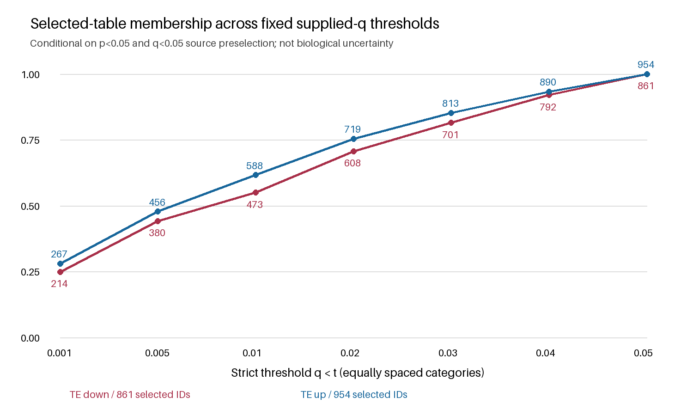
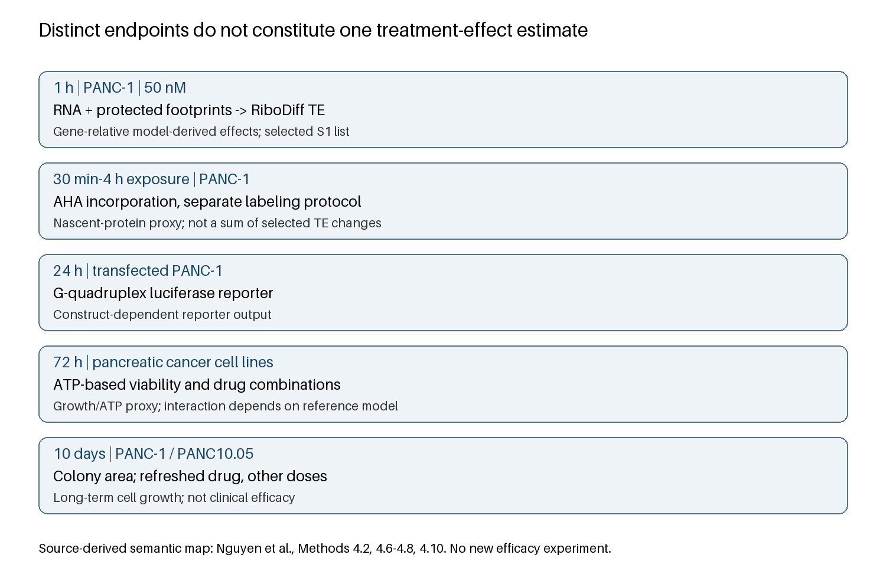

# [Re] Partial reconstruction and endpoint audit of rapamycin-associated translational-efficiency lists in pancreatic cancer cells

## Abstract

Published translational-efficiency lists can be computationally recoverable without making the underlying inference reproducible. We examined the publicly supplied pancreatic-cancer rapamycin table from Nguyen et al., separating list reconstruction from model refitting and biological interpretation. A post-exposure plan fixed seven supplied-q thresholds, literal-identifier checks, effect-magnitude bands and endpoint mapping before new calculations. Direct workbook parsing recovered 1815 selected entries and the reported 473 down/588 up entries at q<0.01. Tightening q<0.05 to q<0.01 retained 58.46% overall, 54.94% down and 61.64% up. The less-stringent-only band contained 754 entries, including 163 with absolute log2 TE effects at least 2. Two repeated gene symbols occurred in opposing directions despite distinct Ensembl identifiers. No signed-effect conflict occurred at the literal-ID level. The source separately measured early footprint-derived TE, metabolic labeling, reporters, viability and colony growth; these endpoints cannot be merged into one therapeutic-effect estimate. This partial reconstruction supports source-list consistency and identifies annotation and interpretation hazards. It does not reconstruct the full tested universe, identify the correction algorithm, refit RiboDiff, establish Figure 1F membership identity or validate clinical efficacy.

## Introduction

Ribosome-associated measurements span several experimental and statistical targets. A gene-level change in modeled translation efficiency (TE) is not identical to a change in total RNA, newly synthesized protein, reporter activity or long-term cell growth. Disagreement between those quantities can reflect the estimand and exposure window rather than an erroneous experiment. In secondary analysis, a further distinction is required between recovering a published selected list and rerunning the inferential procedure that produced it.

Nguyen and colleagues studied rapamycin-associated translation in pancreatic cancer cell lines [1]. Their sequencing comparison used PANC-1 cells exposed to 50 nM rapamycin or DMSO for one hour, with n=3 reported per condition. The article reports 473 decreased and 588 increased TE genes at q<0.01, and 861 and 954 respectively at q<0.05. Supplementary Table S1A/B supplies p-values, q-values and log2 TE effects but is explicitly preselected at p<0.05 and q<0.05. Recovering the latter counts is consequently a consistency check, not independent confirmation of differential-translation inference.

Our objective was narrower: quantify how the supplied list changes across fixed thresholds, determine whether apparent directional conflicts depend on the identifier key, and specify the limits of translating the list into protein or treatment claims. This is a partial reconstruction with exploratory extensions. It neither disputes the original mechanistic study nor presents an independently validated therapeutic finding.

## Methods

### Evidence scope and exposure

The original article, its supplied workbook, earlier extraction and verification code were read locally. All parent artifacts remained read-only. The previously known four published counts and the selected-row total were disclosed before freezing the new plan. The timestamped plan and input SHA-256 values were saved before computing the present robustness summaries. This local freeze is post-exposure, not prospective registration or an unused validation set. No network requests were made in this branch; no raw reads, private manuscripts or patient records were acquired.

### Source parsing and analytical unit

We read the original Table S1 worksheet with openpyxl, retained worksheet row anchors and literal Ensembl identifiers, and compared every row with the prior CSV. A separate standard-library OOXML/Decimal parser served as a cross-check. Direction was assigned from the explicit decreased/increased panel labels and checked against numeric signs, not inferred by fitting the published counts. Symbols were not normalized, merged or updated. The analytical unit is a listed gene identifier, not a patient or independent experimental replicate.

### Fixed descriptive analyses

Strict supplied-q cutoffs were 0.001, 0.005, 0.01, 0.02, 0.03, 0.04 and 0.05, with no additional effect-size cutoff. For each direction and the combined list, we calculated membership counts, retention relative to its selected q<0.05 denominator, and adjacent-threshold Jaccard overlap. Because these sets are nested, Jaccard equals the smaller/larger count ratio. It does not estimate replication probability, biological stability or robustness to refitting.

We compared the fixed q<0.01 and 0.01<=q<0.05 bands using absolute log2 TE quartiles, linearly interpolated, and counts at magnitudes at least 1 and 2. These magnitude landmarks are descriptive, not optimized selection rules. No new significance tests, pathway enrichment or q-value correction were performed. Exact threshold equality, the nearest selected q-values on either side and counts within a fixed +/-10% threshold window describe boundary proximity. The upper window at 0.05 is censored by source selection.

### Identity and endpoint checks

We checked identifier format, duplicate IDs and symbols, cross-direction overlap, finite numeric fields, p/q ranges and signed-effect agreement. The descriptive observation q>=p cannot identify a multiple-testing procedure. Endpoint mapping used the article's Results 2.1-2.4 and Methods 4.2-4.10. Two already available primary studies [2,3] were read for concrete assay/model comparison, not as a systematic novelty search or independent cross-disease validation.

## Results

### Threshold-dependent list membership

The workbook contained 1815 entries with 1815 distinct literal Ensembl IDs. Published q<0.01 and q<0.05 directional counts were recovered (Table 1). At the most stringent fixed threshold, q<0.001, 481 entries remained. The q<0.01 set retained 1061/1815 entries (58.46%); 754 belonged only to the less-stringent band. Directional retention was 473/861 (54.94%) down and 588/954 (61.64%) up. The direction-specific retention difference is descriptive: it is not a calibrated test of different biological responsiveness.

### Table 1. Fixed-threshold counts conditional on the supplied selected table

| Supplied q threshold | TE down | TE up | Total | Retained of selected 1815 (%) |
| --- | --- | --- | --- | --- |
| 0.001 | 214 | 267 | 481 | 26.50 |
| 0.005 | 380 | 456 | 836 | 46.06 |
| 0.01 | 473 | 588 | 1061 | 58.46 |
| 0.02 | 608 | 719 | 1327 | 73.11 |
| 0.03 | 701 | 813 | 1514 | 83.42 |
| 0.04 | 792 | 890 | 1682 | 92.67 |
| 0.05 | 861 | 954 | 1815 | 100.00 |

Figure 1. Retention of literal-ID memberships across fixed strict supplied-q thresholds. Lines connect equally spaced threshold categories, not a continuous fitted relationship. Denominators are 861 down and 954 up selected entries; labels give actual counts. This does not show uncertainty across experimental repeats.

### Effect magnitude is not interchangeable with threshold membership

Median absolute log2 TE was 1.344 in the stringent down band versus 1.077 in the less-stringent-only down band, and 1.425 versus 1.097 for up entries (Table 2). Distributions overlapped substantially. Of 754 less-stringent-only entries, 413 had absolute log2 TE at least 1 and 163 at least 2; the corresponding stringent-band counts were 745 and 292 among 1061 entries. Thus, removal by a smaller supplied-q threshold is not equivalent to removal of all large-magnitude effects. This does not establish that less-stringent entries are true discoveries: standard errors, count structure and refit uncertainty were unavailable.

### Table 2. Absolute supplied log2 TE effect distributions

| Direction / supplied-q band | n | Median absolute log2 TE | IQR | Absolute log2 >=1 | Absolute log2 >=2 |
| --- | --- | --- | --- | --- | --- |
| down / q<0.01 | 473 | 1.344 | 0.902-2.157 | 318 | 141 |
| down / 0.01<=q<0.05 | 388 | 1.077 | 0.622-1.885 | 206 | 94 |
| up / q<0.01 | 588 | 1.425 | 0.955-2.029 | 427 | 151 |
| up / 0.01<=q<0.05 | 366 | 1.097 | 0.707-1.732 | 207 | 69 |

### Boundary proximity and identifier-dependent apparent conflicts

No supplied q-value equaled any fixed threshold exactly. At q=0.01, 81 selected entries lay within the fixed +/-10% window: 36 down and 45 up. At q=0.05, the corresponding count was 66, but only the selected lower-side portion could be observed (Supplementary Table S1). Absence of selected q-values above 0.05 is not evidence for a natural gap or low boundary uncertainty. Our checks cannot recover unlisted near-threshold entries.

No malformed literal ID, missing symbol, nonfinite number, out-of-range p/q, duplicate literal ID, cross-direction literal-ID overlap or effect-sign conflict was detected. Two exact symbols, PAGR1 and KIAA0391, each mapped to two distinct listed Ensembl IDs in opposing panels. PAGR1 paired ENSG00000185928 (down, row 520) with ENSG00000263136 (up, row 874); KIAA0391 paired ENSG00000258790 (down, row 720) with ENSG00000100890 (up, row 1728). This is an annotation-key collision, not proof of contradictory effects for one gene or an error in the article. Without source-version identity adjudication, collapsing symbols would create an unjustified direction conflict.

### Endpoint separation

The sequencing endpoint concerns early model-derived, gene-relative TE. AHA incorporation measures a separate nascent-protein proxy with its own labeling protocol; the source reports up to about 10% inhibition at one hour and about 50% at four hours. Relative TE increases for selected transcripts do not contradict reduced aggregate synthesis. The selected list has no abundance weights or absolute synthesis denominator with which to compute that aggregate.

The G-quadruplex reporter used a 24-hour exposure, ATP-based viability a 72-hour assay, and clonogenic growth a 10-day protocol with different drug doses and replenishment. The original combination results also depended on the chosen ZIP, Bliss, Loewe or HSA reference. Results 2.4 state that PANC-1 synergy-score p-values were not significant and that combined sensitivity was not greater than CR-1-31B alone in either cell line. We preserve these narrower observations rather than infer proven synergy or clinical superiority from the TE list.

Figure 2. Source-derived endpoint map. Boxes are distinct experiments, not a causal chain established by this reanalysis. Assay timing, material and readout prevent a single pooled treatment-effect interpretation.

## Discussion

### What was reconstructed

This work reconstructs selected-table membership and count consistency. It also supplies executed threshold, magnitude and identifier audits beyond simple re-enumeration. The most actionable additional finding is the distinction between stable literal-ID directions and symbol-level collisions. Literal identifiers should remain the computational key until a justified annotation mapping is available. Our results also show that tightening the supplied threshold changes list membership substantially without cleanly separating large from small effects.

These observations are conditional on prior source selection. They cannot validate a false-discovery rate, identify the adjustment algorithm, estimate false-positive prevalence or characterize all tested genes. The article mentions 20,213 protein-coding genes in its mapping description, but this is not an available complete tested-ID universe and is not used as a hypothesis denominator. We did not reconstruct p-values, normalization, dispersions, coefficients or the original RiboDiff execution. Original Figure 1F memberships are unavailable, so count equality is not set-identity verification against that figure.

### Comparison with literature actually inspected

Table 3 specifies the concrete distinction from three read primary sources. Nguyen et al. already provide the feedback-signaling hypothesis, protein checks and functional assays; claiming discovery of those mechanisms here would be false novelty. Ghosh et al. isolate ribosome-enriched RNA with a sucrose cushion and analyze fraction-specific differential expression; their separate puromycin assay addresses nascent synthesis [2]. Kim et al. use RNase-protected footprints, RNA abundance and DESeq-derived TE, with z-score-defined groups in the displayed analyses [3]. The common word translation does not make these selection rules interchangeable. Their contrasting designs motivate an endpoint-aware multi-case methods evaluation, not a common cross-disease treatment recommendation.

### Table 3. Bounded literature comparison, not a comprehensive novelty assessment

| Study actually read | Endpoint / selection | What this analysis adds; what it does not |
| --- | --- | --- |
| Nguyen et al. [1] | PANC-1 RNA/footprints; RiboDiff supplied q; separate protein/growth assays | Adds fixed-threshold retention, effect-band and identity audits; no new mechanism or refit |
| Ghosh et al. [2] | Rat neurons, ribosome-enriched pellet RNA vs total; DESeq/BH; separate SUnSET | Shows why fraction-enrichment contrasts cannot be relabeled footprint TE; no new AD reanalysis |
| Kim et al. [3] | Mouse caudate putamen footprints/total RNA; DESeq-derived TE, z-score grouping | Shows why z-score membership is not supplied-q membership; no PDAC-to-PD efficacy transfer |

The present analysis does not establish a new TE model, a new reproducibility framework or an original biological mechanism. Its potential value is a transparent worked example of the boundary between source-list reconstruction and inferential replication. A separate conventional original-research paper is not presently justified by threshold descriptors alone. An integrated methodological study remains an alternative future direction, but would require a common falsifiable question and preservation of case-specific boundaries. The present submission is instead a bounded single-source partial reconstruction, not a conventional original-methods or disease-discovery paper. Neither this separate format nor a combined narrative establishes transferability.

### Partial-replication venue and remaining evidence

The locally inspected ReScience C instructions allow partial replication and do not require novel research significance. They do require original code, substantial evidence for the claimed replication, reviewer execution and eventual openly licensed code/data [4-6]. Consequently, lack of biological novelty alone is not grounds to rule out that venue. Nevertheless, re-enumerating an already selected table is a weak basis for claiming substantial replication. The present extensions improve audit substance but do not independently replicate inferential outputs. A defensible eventual submission would specify exactly the Figure 1F count claim recovered and distinguish all new descriptive analyses from original claims. Eligibility is for editors and reviewers to judge; no acceptance is presumed.

A material next step would be lawful access to the processed full-universe output plus sample/design metadata and a documented model command, followed by a separately frozen analysis that can compare original and independently reconstructed endpoints. No such output was obtained here, and its availability has not been ruled out. If those inputs remain unavailable, a carefully bounded data-audit or partial-reconstruction note may be possible, but a negative-replication claim would be unwarranted. We did not contact authors or open public repositories.

### Limitations and conclusion

This is an exposed, purposively selected, single-workbook case. Both parsers share the same source and semantic interpretation; their agreement is not independent biological replication. Software fixtures test enumerated behaviors, not empirical paper-error detection accuracy. No independent human adjudication, target-journal formatting review, systematic novelty search or external reproducibility test has been completed. Library n=3 is not three patients, and independence of preparation requires source-level confirmation. The source's separate protein and growth experiments were interpreted from text, not quantitatively reanalyzed.

In conclusion, the selected rapamycin TE list is internally reconstructable and permits useful conditional threshold and identity checks. Its evidential boundary must remain explicit: selected-list consistency is neither full RiboDiff reproduction nor clinical efficacy validation.

## Declarations

**Author and correspondence:** ByungGyu Yoo, Independent Researcher, Incheon, Republic of Korea. ORCID: 0009-0009-8158-758X. Correspondence: ppitu009@gmail.com.

**Funding:** The author received no external funding for this work.

**Competing interests:** The author declares no competing interests and no close collaborative relationship with the authors of the original study.

**Contributions and accountability:** The accountable author authorized the research direction, public release and submission, and accepts responsibility for the work. The computational implementation, analysis, drafting and critique received substantive AI assistance as disclosed below; these tasks are not falsely attributed to an independent human reviewer. AI systems are not authors.

**Ethics:** This work reanalyses publicly available processed experimental tables. It involved no new human participants, patient-level data collection or animal experiments. No original-study animal ethics approval is represented as approval for this secondary analysis.

**Data and code:** Source workbooks remain with their original publishers and must be obtained separately; original source licenses and third-party exceptions are unchanged. Public code, input hashes, headers, source attribution, numerical reference summaries, coverage map and isolated tests are available at https://github.com/poilcer/translation-table-replay/tree/e1133cdd3d14705bdc88623f64773b885b6e87c9. The extensions.py runner reproduces the workbook-derived numerical extensions from one external workbook per study; it does not require a private sibling directory or prior CSV exports. Original workbooks and full source matrices are not redistributed. No archival DOI for this new work has been assigned.

**Related work and exclusivity:** This is one of three distinct-source partial reconstructions from an outcome-exposed, purposively selected research programme, not a new held-out validation. A related TSC manuscript entitled "Tracing analytical targets before comparing gene counts: a reproducibility case study in tuberous sclerosis research" was submitted to Science Editing (temporary reference 20260133). This statement records that submission history, not acceptance or a freshly certified editorial status. The other companion manuscripts use different original studies; shared conceptual and software elements are disclosed and no independent cross-disease validation is claimed. These three current manuscripts have not been submitted elsewhere by this programme. Each must be considered as a bounded partial reconstruction, not as a newly validated general methodology.

**AI-use disclosure:** OpenAI gpt-6.1-sol operating through Hermes assisted source inspection, analysis design, code development, numerical work, original figures, verification and substantial manuscript drafting. Anthropic Claude through the authenticated Claude Code CLI subsequently provided read-only scientific and code critique. Hermes checked the critique against actual artifacts, applied supported revisions and reran computations. Actual runtime records are retained. These AI checks are not independent human peer review or biological validation, and no source-author endorsement is claimed.

**License and approval:** The author approved public release and submission. This manuscript and its newly created figures are licensed CC BY 4.0; the new computational software is MIT-licensed. These grants do not relicense the original publications, workbooks or source data.
## References

1. Nguyen TU, Hector H, Pederson EN, Lin J, Ouyang Z, Wendel HG, Singh K. Rapamycin-Induced Feedback Activation of eIF4E-EIF4A Dependent mRNA Translation in Pancreatic Cancer. Cancers. 2023;15(5):1444. doi:10.3390/cancers15051444. Primary article Methods/Results and Table S1 directly inspected.
2. Ghosh A, Mizuno K, Tiwari SS, et al. Alzheimer's disease-related dysregulation of mRNA translation causes key pathological features with ageing. Translational Psychiatry. 2020. doi:10.1038/s41398-020-00882-7. Local primary article Methods and relevant Results directly inspected; no new table reanalysis here.
3. Kim JW, Yin X, Martin I, Xiong Y, Eacker SM, Ingolia NT, Dawson TM, Dawson VL. Dysregulated mRNA Translation in the G2019S LRRK2 and LRRK2 Knock-Out Mouse Brains. eNeuro. Article identifier ENEURO.0310-21.2021. PMID:34759048. Local primary Methods, TE Results and Discussion inspected; bibliographic date/DOI not inferred.
4. ReScience C. Frequently Asked Questions. Official page locally saved as venue_1.md by parent research lane; sections on replication/reproduction, fees and open licensing inspected.
5. ReScience C. Overview of the submission process. Official page locally saved as venue_2.md; publication criteria and open-access sections inspected.
6. ReScience C. The reviewing process. Official page locally saved as venue_3.md; partial-replication and novelty criteria inspected. Venue documents support publishing-process statements, not biology.
